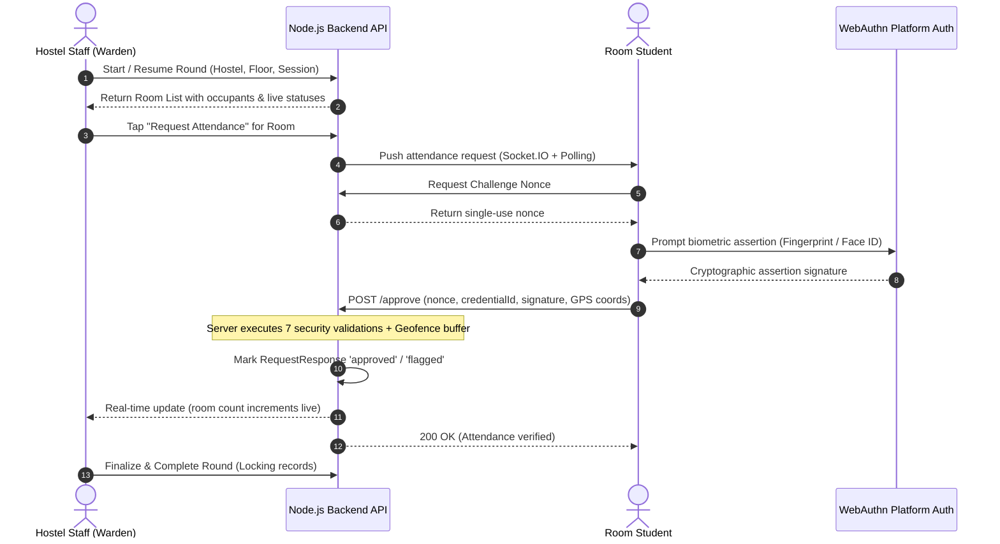

# Room-by-Room Hostel Attendance Module

## 1. Overview & Objectives
The Room-by-Room Attendance module digitizes the traditional paper-sheet night rounds conducted by hostel staff across hostel wings and floors.

### Key Capabilities & Philosophy:
1. **Zero Scanner Hardware:** Staff do not scan QR codes, NFC tags, barcodes, or BLE beacons to verify rooms. Staff navigate to their assigned floor on their phone/tablet, walk room to room, and tap **"Request Attendance"**.
2. **Student Platform Authenticator:** Occupants in the room receive real-time notifications via WebSocket/polling and verify attendance using their phone's native platform authenticator (WebAuthn biometric: Face ID, Fingerprint, Touch ID, Windows Hello).
3. **Server-Side Indoor Geofencing:** GPS coordinates are captured solely to confirm that the student is physically inside the hostel perimeter. All geometry calculations (Ray-Casting Point-in-Polygon, Great-Circle geodesic distance, 25m indoor drift buffer absorption, and 50m accuracy threshold) run strictly on the **server**. GPS data is never exposed publicly and coordinates are stored with privacy controls.
4. **Exception-Only Staff Workflow:** Staff only intervene for students who are absent, unverified, or flagged. Manual overrides require a mandatory, non-empty reason that is permanently recorded in the immutable audit log.
5. **Zero Disruption to Existing Services:** Entire module sits behind the environment toggle `ATTENDANCE_MODULE_ENABLED=true` and is 100% additive to existing MongoDB schemas.

---

## 2. Architecture & Data Flow



---

## 3. Database Schema Models

All collections are additive and non-destructive:

| Collection | Schema File | Purpose & Indexes |
|---|---|---|
| `HostelGeofence` | `backend/models/HostelGeofence.js` | Polygon coordinates, buffer distance (`buffer_m`), accuracy threshold (`accuracy_threshold_m`). Index: `{ hostel: 1 }` |
| `AttendanceRound` | `backend/models/AttendanceRound.js` | Floor round metadata (`hostel`, `floor`, `session_name`, `status`, `staff_id`, `completed_summary`). Index: `{ hostel: 1, floor: 1, date: 1 }` |
| `RoomAttendanceRequest` | `backend/models/RoomAttendanceRequest.js` | Ephemeral room window with TTL (90s default), challenge nonce, and skip tracking. Index: `{ round_id: 1, roomNo: 1 }`, `{ expires_at: 1 }` |
| `RequestResponse` | `backend/models/RequestResponse.js` | Per-student response state (`approved`, `flagged`, `manual_present`, `manual_absent`, `on_leave`). Compound Index: `{ request_id: 1, student_id: 1 }` (unique) |
| `AttendanceRecord` | `backend/models/AttendanceRecord.js` | Permanent attendance register. Compound Unique Index: `{ student_id: 1, date: 1, session: 1 }` |
| `StudentDevice` | `backend/models/StudentDevice.js` | Enrolled platform authenticators, WebAuthn credentials, and explicit student consent timestamps. Index: `{ student_id: 1 }` |
| `AttendanceAuditLog` | `backend/models/AttendanceAuditLog.js` | Immutable audit log capturing actor ID, role, action, old/new value diffs, and mandatory reasons. Index: `{ action: 1, createdAt: -1 }` |

---

## 4. REST API Reference

### Staff Endpoints (Role: `warden`, `admin`)
- `GET /api/attendance/options` — Hostels and dynamic floor numbers detected from assigned student rooms.
- `POST /api/attendance/rounds/start` — Start new round or resume active round for (hostel, floor, session).
- `GET /api/attendance/rounds/:id/rooms` — Live room list with occupant counts, approved counts, remaining countdown timers, and skip indicators.
- `GET /api/attendance/rounds/:id/rooms/:roomNo` — Detailed room occupant roster, home visit leave status, device registration status, and manual override history.
- `POST /api/attendance/rounds/:id/rooms/:roomNo/request` — Dispatch attendance request to room occupants (auto-checks `HomeVisitLog` for active leave).
- `POST /api/attendance/requests/:id/resend` — Reset countdown timer and re-issue single-use challenge nonce.
- `POST /api/attendance/rounds/:id/rooms/:roomNo/skip` — Mark room as skipped (enforces non-empty `reason`).
- `POST /api/attendance/rounds/:id/rooms/:roomNo/reopen` — Reopen skipped room.
- `POST /api/attendance/requests/:id/override` — Manually mark individual student (`manual_present`, `manual_absent`, `manual_on_leave`). **Enforces mandatory non-empty `remark`**.
- `POST /api/attendance/rounds/:id/complete` — Finalize and lock round. Validates that 100% of rooms are either Completed or Skipped. Upserts official `AttendanceRecord`s.
- `POST /api/attendance/rounds/:id/admin-reopen` — Admin-only round unlock.

### Student Endpoints (Role: `student`)
- `GET /api/attendance/pending` — Polling fallback to check if staff is currently outside student's room.
- `GET /api/attendance/challenge/:requestId` — Fetch server-issued challenge nonce.
- `POST /api/attendance/requests/:requestId/approve` — Submit biometric assertion and GPS coordinates for validation.
- `GET /api/attendance/history` — View personal historical attendance register.
- `GET /api/attendance/devices/status` — Check device enrollment and approval status.
- `POST /api/attendance/devices/register` — Enroll mobile platform authenticator with mandatory consent.

### Security & Reports Endpoints (Role: `warden`, `security`, `admin`)
- `GET /api/attendance/summary` — Read-only dashboard summary (total students, present, absent, on leave, unresolved, anomalies feed).
- `GET /api/attendance/reports` — Filterable audit reports with date range, hostel, floor, and format (`format=csv` downloads RFC-4180 compliant CSV).

---

## 5. Security & Verification Engine

When a student calls `POST /api/attendance/requests/:requestId/approve`, the server sequentially performs 7 strict checks:

```
[Incoming Approval]
       │
       ▼
1. Is request open and not expired? (expires_at > now) ──────► ❌ REJECT (REQUEST_EXPIRED)
       │
       ▼
2. Is student officially assigned to this room? ─────────────► ❌ REJECT (NOT_IN_ROOM_ROSTER)
       │
       ▼
3. Is student on approved leave? ────────────────────────────► ❌ REJECT (ON_LEAVE)
       │
       ▼
4. Already approved? ────────────────────────────────────────► ℹ️ IDEMPOTENT (ALREADY_APPROVED)
       │
       ▼
5. Server nonce valid and unused? ───────────────────────────► ❌ REJECT (NONCE_INVALID)
       │
       ▼
6. Credential matches enrolled StudentDevice? ───────────────► ❌ REJECT (DEVICE_MISMATCH)
       │
       ▼
7. GPS accuracy within 50m threshold? ───────────────────────► ❌ REJECT (LOW_GPS_ACCURACY)
       │
       ▼
8. Geofence point-in-polygon or within 25m buffer? ──────────► ❌ REJECT & FLAG (OUTSIDE_GEOFENCE)
       │
       ▼
[Check for Anomalies: DEVICE_SHARING, MOCK_LOCATION]
       │
       ▼
[Save Verified Response & Broadcast Live Update]
```

---

## 6. Real-Time & Offline Resilience

- **Primary:** Socket.IO pushes `attendance_requested` directly to private student channels (`user:${id}`, `student:${id}`) and broadcasts `room_attendance_updated` on `/dashboard`.
- **Secondary (Proxies / Intermittent Network):** Automatic polling fallback every 3.5 seconds on the student dashboard, ensuring zero missed requests.
- **Indoor GPS Drift Buffer:** 25-meter metric projection around the hostel polygon perimeter absorbs reinforced-concrete multi-path drift.
- **Zero Scan Latency:** Staff screen badges pulse green instantly upon room occupant approvals.

---

## 7. Migration & Rollback Guide

### Initialize module & seed geofences:
```bash
node scripts/initAttendanceModule.js
```

### Seed demo data (BH1 floor 2 rooms, students, enrolled devices):
```bash
node scripts/seedAttendanceDemo.js
```

### Rollback / Tear down attendance indexes and geofences:
```bash
node scripts/initAttendanceModule.js --rollback
```

### Execute Test Suites:
```bash
node tests/attendance_phase2.test.js
node tests/attendance_phase3.test.js
node tests/attendance_phase4.test.js
node tests/attendance_phase5.test.js
node tests/attendance_phase6.test.js
node tests/attendance_e2e_integration.test.js
```
